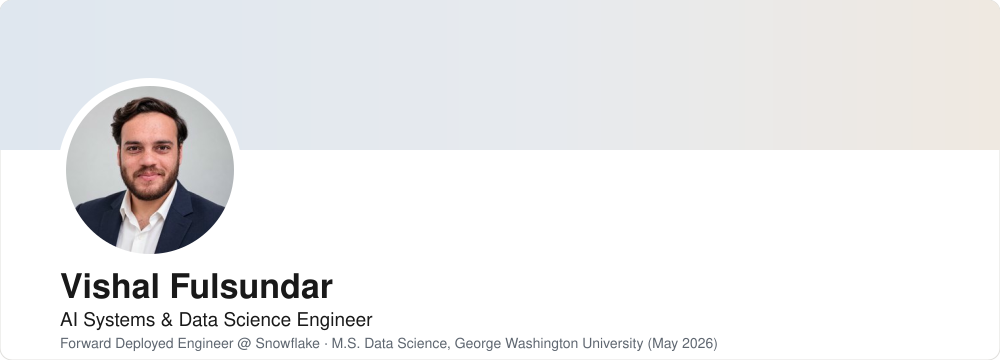

## About

I build production ML systems, multi-agent AI pipelines and LLM research. Currently finishing an M.S. in Data Science at George Washington University.

- Agentic RAG with evidence grading, query rewriting and cited refusal
- LLM memory governance, audit trails and fail-closed design
- Hallucination detection and transformer interpretability research
- Evaluation-first engineering: benchmarks, labelled sets, offline test suites
- Full-stack delivery: FastAPI, Next.js, Docker, Supabase, serverless AWS

**See everything in one place:** [my portfolio](https://vishalgwu.github.io/vishal-portfolio/) lists all 31 projects with architecture notes and results. Source: [vishalgwu/vishal-portfolio](https://github.com/vishalgwu/vishal-portfolio).

## Experience

| Role & employer | Dates | Selected work |
|---|---|---|
| **Forward Deployed Engineer · CrossCountry Consulting** | Jan 2026 – Present | Built FastAPI services for Coupa-to-ERP accrual workflows with 94% auto-match. Reduced reviewer preparation from 11 to 5 minutes across 80 paired invoice trials using LangGraph and policy retrieval, with controller approval gates. |
| **ML Engineer · Zoho** | Sep 2022 – Jul 2024 | Built leakage-safe CRM lead-scoring features and scikit-learn classifiers. Improved precision from 61% to 68% across 1,200 labeled leads while retaining 72% recall, using chronological holdout validation and threshold tuning. |
| **Data Analyst · Cactus Communications** | Jun 2021 – May 2022 | Used SQL and Python to reconcile editorial workflow records, standardize timestamps, and produce operational reports. Reduced weekly manuscript status discrepancies from 18 to 8. |

## Education

**George Washington University** · M.S. Data Science · GPA 3.87 · May 2026

## Featured projects

| Project | What it is | Results (from each repo) |
|---|---|---|
| [Tento Resident OS](https://github.com/vishalgwu/tento-agents) | Deployed GenAI maintenance platform with Next.js, FastAPI, GPT-4.1-mini, LangGraph, Supabase and Upstash | Four role workspaces; tenant-scoped policy retrieval; durable jobs; 339 passing Python tests; [live application](https://tento-resident-os.vercel.app/) |
| [HR Agentic RAG Copilot](https://github.com/vishalgwu/Enterprise-HR-Policy-And-Employee-Support-Agentic-Rag-Copilot) | Production agentic RAG: 11-node LangGraph agent, supervisor-worker team, hybrid retrieval, guardrails, approval queue and a cost model | 21/21 routing and grading decisions; 652 offline tests, zero lint findings; answers with no API keys at all; [live demo](https://hr-policy-copilot.vercel.app) |
| [AI Engineering Roadmap 2026](https://github.com/vishalgwu/ultimate-ai-engineering-roadmap-2026) | Code-first guide to production AI engineering, delivered as a reading app | 19 chapters, 187 sections; audit with 0 issues; [live site](https://ai-engineering-roadmap-2026-omega.vercel.app) |
| [LLMOps Interview Preparation](https://github.com/vishalgwu/llmops-interview-preparation) | Serving, guardrails, observability and evaluation curriculum | 20 modules, 142 episodes; [live site](https://llmops-interview-preparation.vercel.app) |
| [MLOps Interview Preparation](https://github.com/vishalgwu/mlops-interview-preparation) | Full ML lifecycle curriculum with runnable code and post-mortems | 22 modules, 255 episodes; [live site](https://mlops-interview-preparation.vercel.app) |
| [Maryland UI Pulse](https://github.com/vishalgwu/maryland-ui-timeliness) | Analytics app on how fast Maryland pays unemployment insurance | 72.5% paid within 21 days vs the 87% standard, 48th of 53; [live demo](https://maryland-ui-pulse.vercel.app) |
| [GuardMem AI](https://github.com/vishalgwu/HGEM) | Memory governance gateway for long-running LLM agents | MCP + REST, Postgres RLS, hash-chained audit log; in active build |
| [Latent Instability Diagnostics](https://github.com/vishalgwu/Latent-Instability-Diagnostics-LID) | Flags LLM hallucinations a token before they are emitted | 0.71 AUROC on TruthfulQA at 15-20% overhead |
| [Fashion Image Captioner](https://github.com/vishalgwu/Image_caption_generator) | 48M-parameter CNN-Transformer vs Qwen2-VL and BLIP-2 | 0.82 CIDEr; p95 latency down 41% with vLLM |
| [WillDocs RAG](https://github.com/vishalgwu/Will_Docs) | Streaming PDF chat on LlamaIndex, Qdrant and FastAPI | recall@5 from 71% to 84% |
| [Jarvis Job Globe](https://github.com/vishalgwu/job-globe.com) | Geospatial job discovery on a WebGL globe | [live demo](https://job-globe-com-web.vercel.app) |

## Research

**Token influence and temperature effects in LLM responses** (March 2026 to present)
LLM outputs collapse into 2-cycle attractors at low temperature, mapped to logistic-map period-doubling. Built a framework to measure how RAG shifts cluster stability across GPT, LLaMA and Qwen.

**Text Summarization in NLP** · JETIR, Vol. 10 (Oct 2023)
Extractive versus abstractive summarization with transformers on BBC News data.

## Skills

| | |
|---|---|
| **ML & GenAI** | PyTorch · TensorFlow · Scikit-learn · LangChain · LangGraph · LlamaIndex · RAG · FAISS · XGBoost · Grad-CAM · LIME |
| **Cloud & MLOps** | AWS S3 · Lambda · EC2 · Bedrock · SageMaker · API Gateway · Docker · MLflow |
| **Data engineering** | PySpark · Spark · Hadoop · ETL pipelines · Parquet · Data lakes |
| **Databases & tools** | PostgreSQL · MySQL · MongoDB · Neo4j · Qdrant · FastAPI · Streamlit · Git |
| **Visualization** | Tableau · Power BI · Matplotlib · Seaborn · Plotly |

---

Want to talk? <a href="mailto:vishalfulsundar2025@gmail.com">Email me</a> or <a href="https://www.linkedin.com/in/vishalfulsundar/">connect on LinkedIn</a>.

